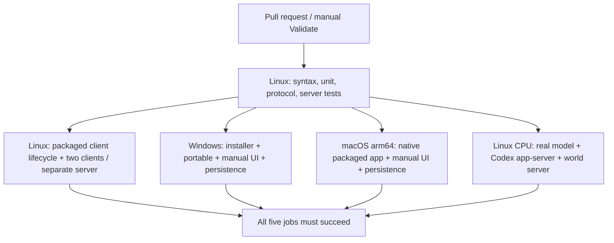
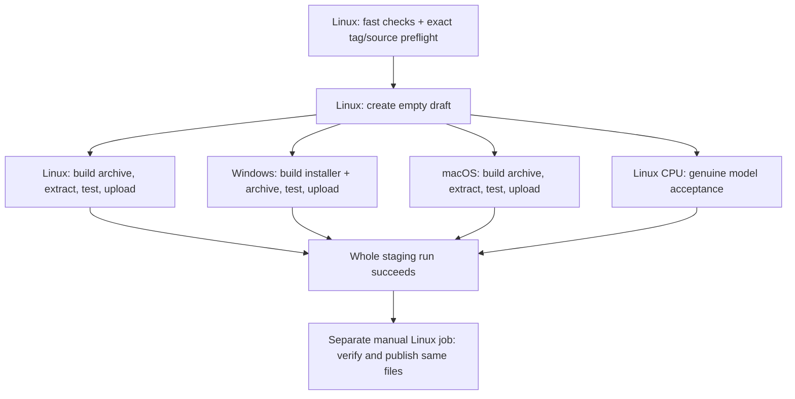

# CI acceptance contract

CI tests the current commit and its own build. It never imports a PASS from another run or compares gameplay with historical releases.

## Pull requests: five runner allocations, at most four concurrently

A runner is a temporary machine. Multiple clients, server processes and model processes inside one job do not allocate additional runners. There is no duplicate push workflow. Diagnostic workflows run only when manually requested.

| Job | Runs inside the runner | Required evidence |
| --- | --- | --- |
| test | Node test runner; temporary world servers | Syntax/unit/protocol checks; two authenticated builders; server-side ownership denial through agent tools; saved state after server restart |
| linux-client | Packaged Electron app, then two isolated packaged Electron clients and a separate Node world server under Xvfb | Real UI create/select/edit/remove; both clients observe changes; foreign edit controls disabled and direct forbidden command rejected; server restart and client reconnect preserve the same objects; late graphics errors fail |
| windows-installer | Installer, installed app and portable app, isolated synthetic profile | Real UI create/select/edit/remove; clean install, restart, portable data access, reinstall, uninstall retention and reinstall after uninstall |
| macos-native | Native Apple Silicon packaged app | arm64 executable; renderer sandbox; real UI create/select/edit/remove; settings/world persist across restart; graphics health |
| model | Pinned Codex app-server, llama.cpp, Qwen3 CPU model, world server and independent authenticated observer | Genuine model invokes world_state and world_build through Codex tools; server persists the requested structure; another user's state agrees |

The observer in model acceptance is an API client, not a second LLM. The two-client Linux test uses real GUI clients but scripted actions. Together these cover protocol/model integration and shared UI behavior; they do not establish two concurrent human/LLM sessions or MMO capacity.

## Release: six staging jobs plus one publication job

Three package jobs and the model job may run concurrently: four runners at peak, seven allocations including publication. Model failure blocks publication even if packages have already reached the draft. Package jobs freeze the final archives before testing, then upload only after their checks pass. Publication verifies this candidate's manifests, hashes, source, tag and successful staging attempt and does not rebuild.

Ordinary PR jobs are read-only. Draft creation, the entire trusted platform build/test/upload jobs and publication have repository contents write permission. No release operation runs on a PR. See [CONTRIBUTING](../CONTRIBUTING.md) for partial-draft handling.

## Test-first changes and failure classification

1. Describe an observable player/server outcome and add its test.
2. For missing or broken behavior, observe that test fail for that behavior in GitHub Actions before changing production code.
3. Fix the smallest production cause, then require the complete suite to pass.
4. Existing supported behavior can pass a newly added regression test immediately. Do not invent a failure or claim a red-green cycle that did not happen.
5. Download failures, syntax errors in tests and incorrect test selectors are not evidence of a product defect. Fix the setup/test or resolve infrastructure before claiming acceptance.

All checks run on GitHub. Current unit tests and a source two-client scenario have passed during development of this contract. Final packaged and model acceptance must be established by the final candidate's own run; those development results do not accept RC3.

## Cost and limits

Only standard ubuntu-24.04, windows-latest and macos-15 runners in this public repository are used. No larger runners, Actions artifact uploads, Actions cache or paid model API calls. The model runs locally on the Linux runner. Job timeouts bound execution; newer PR commits cancel obsolete validation runs. Official model/runtime downloads have bounded retries and SHA-256 checks; persistent failures stop the job.

GitHub documents standard hosted runners for public repositories as free: https://docs.github.com/en/billing/concepts/product-billing/github-actions . Reassess billing before changing repository visibility, runner labels, storage or model providers.

Linux and Windows smoke select SwiftShader explicitly for CI; this does not validate native hardware drivers or fix automatic renderer selection. Normal application startup is unchanged. Windows is unsigned and macOS is ad-hoc signed, Apple Silicon only, without notarization. Real desktop interaction, hardware GPU compatibility and large player counts remain outside automated acceptance.
